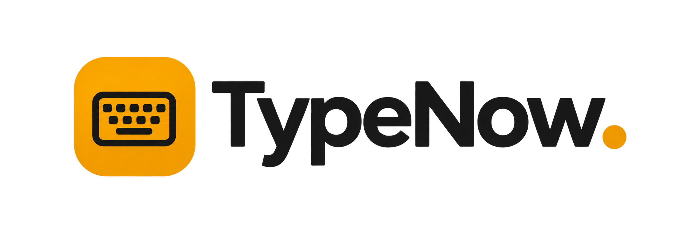
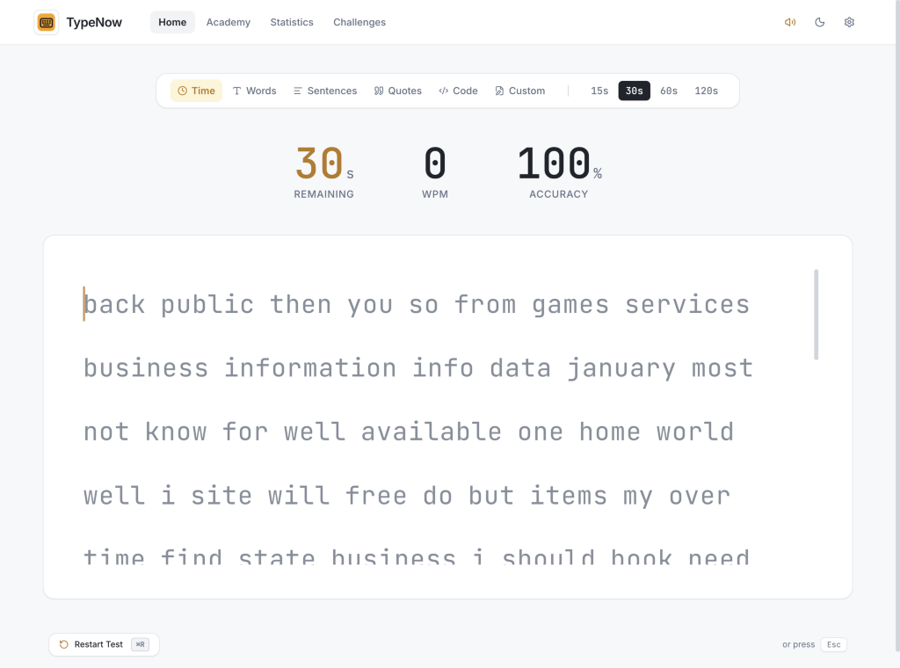
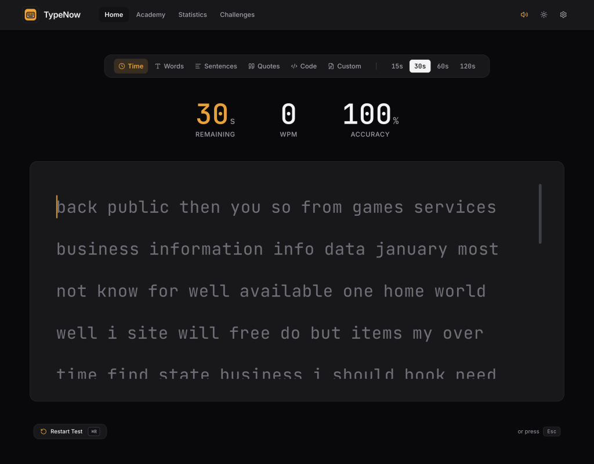
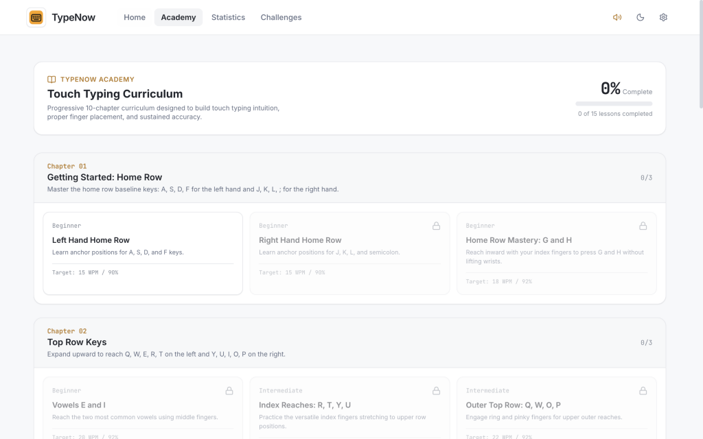
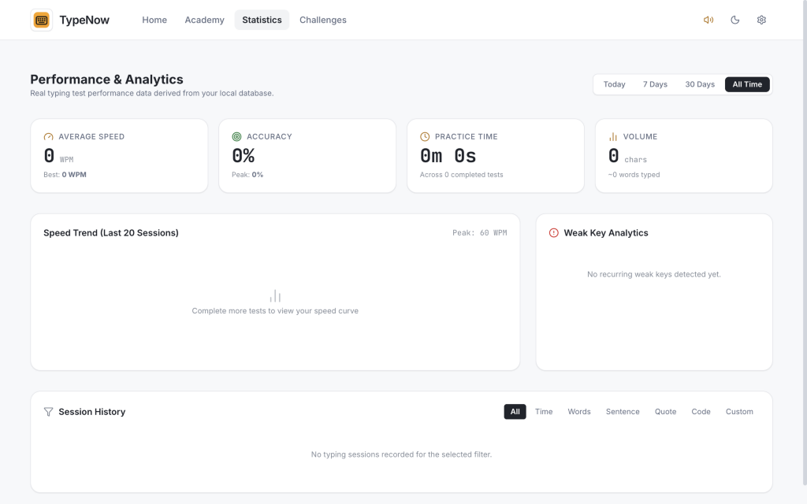
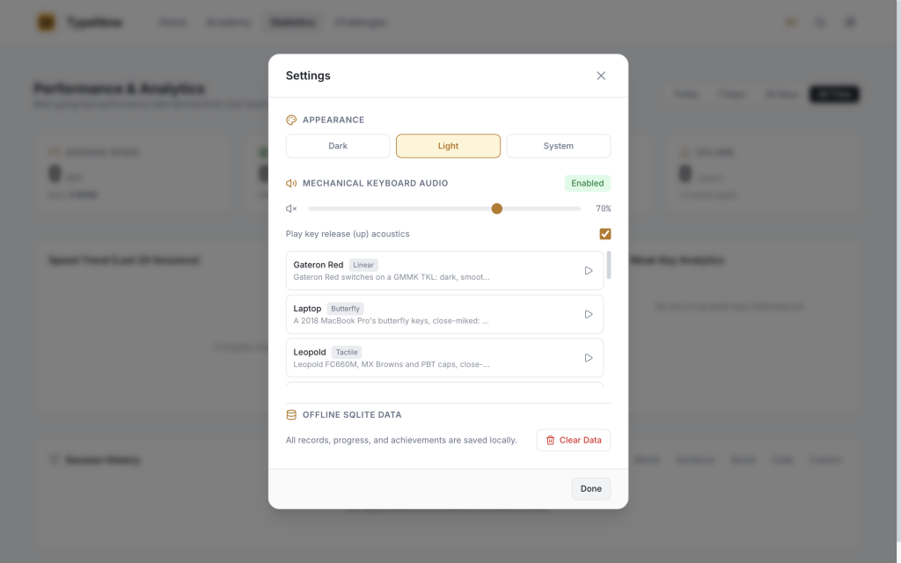

<div align="center">


# TypeNow

**Typing speed, precision, and acoustics — under your control.**

A production-grade, offline-first desktop typing tutor, speed lab, and acoustic mechanical keyboard experience for macOS, Windows, and Linux. Built with Tauri 2, Rust, and React.

<p>
  <a href="https://github.com/0xJihan/TypeNow/releases/latest">
    
  </a>
  
  
  
  
  
  
</p>

[**Download Releases →**](releases/) · [Why TypeNow?](#why-typenow) · [Features](#features) · [Screenshots](#screenshots) · [Installation & Gatekeeper](#installation) · [Usage](#usage) · [Keyboard Shortcuts](#keyboard-shortcuts) · [Tech Stack](#tech-stack) · [Build from source](#build-from-source) · [FAQ](#faq)

</div>

---



<p align="center"><sub><b>TypeNow.</b> Distraction-free desktop typing lab, structured 10-chapter academy, authentic mechanical switch acoustics, and real-time telemetry — 100% offline.</sub></p>

## Why TypeNow?

Most modern typing tests are web pages overloaded with advertisements, third-party trackers, cloud login walls, and sluggish browser rendering. TypeNow is built as a dedicated, high-performance desktop instrument crafted for engineers, writers, and typists who demand instant responsiveness and complete privacy.

- **Offline-first & zero telemetry.** No accounts, no subscriptions, no analytics, and no remote API calls. Your typing history, accuracy graphs, and custom passages remain stored locally in an embedded SQLite database.
- **Ultra-low latency desktop engine.** Powered by Tauri 2 and Rust. Eliminates browser overhead, yielding instantaneous keystroke dispatch, smooth caret tracking, and steady framerates.
- **Authentic mechanical switch acoustics.** Features high-fidelity multi-sampled audio packs (NovelKeys Cream, Gateron Red, Cherry MX Blue/Black, Leopold, IBM Model F, Topre, Selectric, and vintage terminals) with independent press and release acoustics, subtle pitch variations, and volume controls.
- **Dual precision themes.** Includes a warm, editorial Light theme and a deep carbon Dark theme, both engineered with strict WCAG AA contrast, tabular numerals, and zero layout shift.
- **In-depth analytics & diagnostics.** Instantaneous WPM, Net WPM, Accuracy, Consistency, CPM, per-second speed timeline graphs, and automatic weak-key detection to pinpoint error-prone finger reaches.
- **Comprehensive touch-typing curriculum.** A 10-chapter progressive academy guiding you from home row baseline anchors to numbers, punctuation, programming symbols, and high-speed flow drills.

---

## Features

### ⌨️ 6 Flexible test modes

- **Time Mode:** Fixed countdown sprints (15s, 30s, 60s, 120s) with live remaining-time indicators and pacing metrics.
- **Words Mode:** Fixed word counts (10, 25, 50, 100 words) selected from curated, verified English frequency dictionaries.
- **Sentences Mode:** Complete, grammatical English sentences with natural punctuation and capitalization.
- **Quotes Mode:** Curated excerpts from classic literature, philosophy, and historical prose (Short, Medium, Long).
- **Code Syntax Mode:** Real-world programming syntax across 8 languages: TypeScript, Rust, Python, Go, C++, HTML/CSS, SQL, and JSON.
- **Custom Passage Mode:** Paste any text, excerpt, or drill passage directly into the app for customized deliberate practice.

### 🎓 10-Chapter touch-typing academy

- **Progressive curriculum:** 10 curated chapters spanning 15 targeted interactive lessons.
- **Finger anchor training:** Visual guidance starting from Home Row baseline keys (`A, S, D, F` and `J, K, L, ;`) through top-row reaches, bottom-row reaches, shifted punctuation, and numeric row mastery.
- **Interactive visual keyboard:** Real-time visual feedback highlighting target keys and optimal finger assignments.
- **Unlockable milestones:** Minimum WPM and accuracy thresholds ensure solid muscle memory before unlocking advanced drills.

### 🔊 Mechanical switch audio engine

- **Authentic switch packs:** Includes high-fidelity sound recordings of popular switches:
  - Gateron Red (Linear)
  - Cherry MX Blue (Clicky) & Cherry MX Black / Brown (Tactile)
  - Leopold FC660M
  - IBM Model F & Unicomp Buckling Spring
  - Topre Electrostatic Capacitive
  - IBM Selectric & Vintage Technics Typewriters
  - Rainy 75 & WhiteFox custom mechanicals
  - Laptop Butterfly keys
- **Independent acoustics:** Toggle keypress (down) and key-release (up) sounds independently.
- **Anti-fatigue audio:** Multi-sample round-robin selection and micro-pitch variance prevent repetitive audio fatigue.
- **Custom master volume:** Non-blocking Web Audio buffer pool with zero keystroke input delay.

### 📊 Real-time telemetry & weak key analytics

- **Core metrics:** Real-time Gross WPM, Net WPM, Accuracy percentage, and time elapsed.
- **Speed curve timeline:** Interactive per-second speed and error timeline chart generated for every completed test session.
- **Weak key diagnosis:** Identifies your slowest and most error-prone keys, mapping exact character miss frequencies so you know which keys to practice.
- **Durable history:** View your all-time average speed, peak WPM, total practice duration, and session logs filtered by test mode.

### 🎨 Editorial Light & deep carbon Dark themes

- **Editorial Light:** Warm, clean, editorial minimalism inspired by high-end typography and stationery (`#F7F8FA` background, `#20242C` primary text, `#B7791F` warm amber accent).
- **Deep Carbon Dark:** High-contrast, glare-free dark palette (`#0F1115` background, `#FFFFFF` crisp text, `#F59E0B` vibrant amber accent).
- **Tabular figures:** Monospace font metrics and tabular numerals eliminate layout jitter while typing at high speeds.

### 🗄️ Durable local SQLite persistence

- Embedded SQLite database managed through native Rust `rusqlite` with transactional schema migrations.
- Complete data ownership: zero cloud synchronization, zero login requirements.
- One-click database clearing option directly in Settings.

---

## Screenshots

<table width="100%">
  <tr>
    <td width="50%" valign="top">
      
      <p align="center"><sub><b>Editorial Light Theme.</b> Warm, distraction-free minimalism with high-contrast metrics.</sub></p>
    </td>
    <td width="50%" valign="top">
      
      <p align="center"><sub><b>Deep Carbon Dark Theme.</b> Glare-free dark canvas for low-light practice sessions.</sub></p>
    </td>
  </tr>
  <tr>
    <td width="50%" valign="top">
      
      <p align="center"><sub><b>Touch Typing Academy.</b> 10-chapter progressive muscle memory curriculum.</sub></p>
    </td>
    <td width="50%" valign="top">
      
      <p align="center"><sub><b>Performance Analytics.</b> Speed curves, weak key heatmap, and session logs.</sub></p>
    </td>
  </tr>
  <tr>
    <td colspan="2" align="center" valign="top">
      
      <p align="center"><sub><b>Settings & Switch Acoustics.</b> Selectable sound packs, volume control, and local SQLite data management.</sub></p>
    </td>
  </tr>
</table>

---

## Installation

### Requirements

| Platform | Requirements | Details |
|---|---|---|
| **macOS** | macOS 12.0 (Monterey) or later | Apple Silicon (`arm64`) & Intel (`x86_64`) |
| **Windows** | Windows 10 / 11 (64-bit) | Microsoft Edge WebView2 (pre-installed on Win 10/11) |
| **Linux** | Ubuntu 22.04+, Debian 12+, Fedora 38+, Arch Linux | `webkit2gtk-4.1`, `libssl`, `curl` |
| **Disk Space** | ~25 MB installed | Includes all high-definition audio switch packs |
| **Internet** | None required | 100% offline-ready |

### Download pre-built binaries

Pre-built binaries can be downloaded directly from the [**Releases folder**](releases/) in this repository or from the [**GitHub Releases page**](https://github.com/0xJihan/TypeNow/releases/latest):

| Platform | Package Format | Download |
|---|---|---|
| **macOS (Apple Silicon)** | `.dmg` installer | [`TypeNow_0.1.0_aarch64.dmg`](releases/TypeNow_0.1.0_aarch64.dmg) |
| **macOS (Apple Silicon)** | `.zip` portable app | [`TypeNow_0.1.0_macOS_aarch64.zip`](releases/TypeNow_0.1.0_macOS_aarch64.zip) |
| **Windows (x64)** | `.exe` setup installer | [`TypeNow_0.1.0_x64-setup.exe`](releases/TypeNow_0.1.0_x64-setup.exe) |
| **Windows (x64)** | `.zip` standalone portable | [`TypeNow_0.1.0_x64_portable.zip`](releases/TypeNow_0.1.0_x64_portable.zip) |
| **Linux (x64)** | `.AppImage` / `.deb` | [GitHub Releases](https://github.com/0xJihan/TypeNow/releases/latest) |

---

### macOS installation & Gatekeeper troubleshooting

TypeNow is distributed directly as an open-source binary outside the Mac App Store. If the downloaded build has not been notarized with an Apple Developer certificate, macOS Gatekeeper may show a warning or state that the application is "damaged".

> [!TIP]
> **Only bypass Gatekeeper for binaries you downloaded from this official repository.** You can also inspect the complete source code or [build the app yourself](#build-from-source).

#### Method 1: The Drag-and-Drop Terminal command (Fastest)

If macOS displays *“TypeNow is damaged and can’t be opened”* or blocks the app:

1. Open **Terminal** (press `⌘ Space`, type `Terminal`, and press `Enter`).
2. In the Terminal window, type:
   ```bash
   xattr -cr 
   ```
   *(Note: make sure to leave a space after `-cr`)*.
3. Open your **Applications** folder in Finder.
4. **Drag and drop** `TypeNow.app` from the Applications folder directly into your Terminal window. Terminal will automatically fill in the full escaped path, resulting in:
   ```bash
   xattr -cr /Applications/TypeNow.app
   ```
5. Press **Return** (Enter).
6. Double-click **TypeNow** in your Applications folder. It will launch immediately!

#### Method 2: System Settings "Open Anyway"

1. In Finder, open your **Applications** folder and double-click **TypeNow**.
2. If macOS displays a prompt saying *“Apple could not verify TypeNow…”*, click **Done** (do **not** click *Move to Trash*).
3. Open **System Settings** from the Apple menu (``).
4. Navigate to **Privacy & Security** and scroll down to the **Security** section.
5. You will see a notice stating: *“TypeNow was blocked from use because it is not from an identified developer.”*
6. Click **Open Anyway**, authenticate with Touch ID or your password, and click **Open**.
7. You only need to do this once. Subsequent launches will open normally.

#### Method 3: Remove the Quarantine Attribute

Alternatively, run:

```bash
xattr -dr com.apple.quarantine /Applications/TypeNow.app
open /Applications/TypeNow.app
```

---

### Windows installation

#### Option A: Setup Installer (.exe)
1. Download [`TypeNow_0.1.0_x64-setup.exe`](releases/TypeNow_0.1.0_x64-setup.exe).
2. Double-click the installer and follow the setup wizard (creates Desktop and Start Menu shortcuts).
3. If Windows SmartScreen displays *“Windows protected your PC”*, click **More info** and select **Run anyway**.

#### Option B: Standalone Portable (.zip)
1. Download [`TypeNow_0.1.0_x64_portable.zip`](releases/TypeNow_0.1.0_x64_portable.zip).
2. Extract the archive to any folder and double-click `TypeNow.exe`. No installation required.

---

### Linux installation

#### Using AppImage:
```bash
chmod +x TypeNow_0.1.0_amd64.AppImage
./TypeNow_0.1.0_amd64.AppImage
```

#### Using Debian/Ubuntu package:
```bash
sudo dpkg -i typenow_0.1.0_amd64.deb
```

---

## Usage

### Practicing a typing test

1. **Select a mode:** Click any mode in the top selector pill:
   - **Time:** Select 15s, 30s, 60s, or 120s.
   - **Words:** Select 10, 25, 50, or 100 words.
   - **Sentences / Quotes / Code / Custom:** Select your desired text generator.
2. **Begin typing:** Simply start typing in the main typing box. The timer and metrics start automatically on your very first keystroke.
3. **Immediate feedback:** Correct characters appear in sharp primary color, incorrect characters highlight in red, and the active caret guides your position.
4. **Instant reset:** Press `⌘R` (macOS) or `Ctrl+R` (Windows/Linux) or press `Esc` at any time to instantly reset the test with new content.

### Using the Touch Typing Academy

1. Click the **Academy** tab in the navigation header.
2. Select your active lesson (starting with Chapter 01: *Left Hand Home Row*).
3. Follow the target key indicators and finger positioning guide.
4. Achieve the required WPM and Accuracy targets to graduate to subsequent chapters.

### Reviewing performance statistics

1. Click the **Statistics** tab in the navigation header.
2. Filter your metrics across **Today**, **7 Days**, **30 Days**, or **All Time**.
3. Inspect your speed progression graph and view your detected **Weak Keys** to see which character reaches need deliberate practice.

### Customizing mechanical switch acoustics

1. Click the **Settings (gear)** icon in the top right.
2. Under **Mechanical Keyboard Audio**, preview switch sounds by clicking the play button next to any switch pack.
3. Select your favorite sound pack (e.g. *NovelKeys Cream*, *Gateron Red*, *Model F*, or *Topre*).
4. Adjust the volume slider or toggle key-release acoustics to match your preference.

---

## Keyboard shortcuts

| Shortcut | Action | Description |
|---|---|---|
| **⌘R** / **Ctrl+R** | Restart Test | Instantly resets the active test with fresh content |
| **Esc** | Cancel / Reset | Clears the active run or dismisses modal dialogs |
| **Tab + Enter** | Quick Restart | Rapidly regenerates test without leaving home row |
| **Space** | Advance Word | Submits active word buffer and moves to next token |
| **Backspace** | Delete Char | Corrects previous character miss |
| **⌥ Backspace** / **Ctrl+Backspace** | Delete Word | Erases the current active word input |

---

## Tech stack

| Layer | Technology | Purpose |
|---|---|---|
| **Runtime** | Tauri 2.0 | Ultra-lightweight desktop windowing and native bindings |
| **Native Core** | Rust 2021 | Performance-critical operations, file I/O, persistence boundaries |
| **Database** | SQLite via `rusqlite` | Durable offline session history and preferences storage |
| **Frontend** | React 19, TypeScript | Reactive, strict-typed user interface components |
| **Build Tooling** | Vite 8 | Fast HMR dev server and optimized production bundler |
| **Styling** | Tailwind CSS v4 | Semantic design tokens and responsive typography |
| **Audio Engine** | Web Audio API | Multi-sample buffer pool, round-robin playback, micro-pitch jitter |
| **Icons** | Lucide React | Clean, semantic iconography |

### Project structure

```text
type-now/
├── src/                          # React + TypeScript frontend
│   ├── audio/                    # Sound manager, switch pack manifests, audio caching
│   ├── components/               # Cohesive UI components
│   │   ├── academy/              # 10-chapter curriculum views & interactive keyboard
│   │   ├── features/             # Typing test engine, metrics display, mode selectors
│   │   ├── settings/             # Settings modal, sound picker, database management
│   │   ├── shell/                # App header, brand icon, navigation tabs, theme toggle
│   │   ├── stats/                # Telemetry graphs, weak key heatmap, history tables
│   │   └── ui/                   # Reusable primitive controls (Buttons, Sliders, Cards)
│   ├── data/                     # Verified corpora, quotes, programming samples, curriculum
│   ├── hooks/                    # Custom typing engine, audio, and database hooks
│   └── types/                    # Strict TypeScript domain models & preferences
├── src-tauri/                    # Rust backend and native capabilities
│   ├── src/
│   │   ├── db/                   # rusqlite connection manager, schema migrations, models
│   │   ├── lib.rs                # Tauri command handlers (get/save stats, preferences)
│   │   └── main.rs               # Desktop executable entry point
│   ├── icons/                    # Multi-resolution desktop app icons (.icns, .ico, .png)
│   └── tauri.conf.json           # Window sizing, permissions, bundle targets
├── arts/                         # High-resolution screenshots and banners
├── releases/                     # Compiled desktop release packages (.dmg, .zip)
└── public/                       # Audio sound packs, brand assets, favicon
```

---

## Privacy & data ownership

TypeNow is strictly private by design:

- **100% Offline:** The core application runs without requiring any internet connection.
- **Zero Remote Telemetry:** No Google Analytics, no Mixpanel, no Sentry, no tracking pixels, and no remote crash reporting.
- **Local SQLite Storage:** All preferences, test sessions, and academy progress are persisted locally in:
  - **macOS:** `~/Library/Application Support/com.jihan.typenow/typenow.db`
  - **Windows:** `%APPDATA%\com.jihan.typenow\typenow.db`
  - **Linux:** `~/.local/share/com.jihan.typenow/typenow.db`
- **Zero Account Lock-in:** You can wipe your data at any time via Settings -> Clear Data, or delete the database file directly.

---

## Build from source

If you prefer to compile TypeNow from source:

### Prerequisites

1. **Node.js:** Node.js 18+ or 20+ installed ([nodejs.org](https://nodejs.org/)).
2. **Rust:** Latest stable Rust toolchain (`rustup update`).
3. **Platform Build Tools:**
   - **macOS:** Xcode Command Line Tools (`xcode-select --install`).
   - **Windows:** Visual Studio C++ Build Tools & WebView2.
   - **Linux:** WebKitGTK and build essentials (`sudo apt install libwebkit2gtk-4.1-dev build-essential curl wget libssl-dev libgtk-3-dev libayatana-appindicator3-dev librsvg2-dev`).

### Build instructions

```bash
# 1. Clone the repository
git clone https://github.com/0xJihan/TypeNow.git
cd TypeNow

# 2. Install dependencies
npm install

# 3. Run development desktop app with HMR
npm run tauri dev

# 4. Build production bundle for your platform
npx tauri build
```

Compiled application bundles will be located in `src-tauri/target/release/bundle/`.

---

## FAQ

**Does TypeNow require an internet connection?**  
No. TypeNow is completely offline. All word corpora, quotes, programming challenges, audio samples, and SQLite database storage are embedded directly into the desktop binary.

**Where is my data stored?**  
All test sessions, speed logs, academy achievements, and sound preferences are stored locally in `typenow.db` inside your operating system's application support directory.

**Why did macOS show "TypeNow is damaged and can't be opened"?**  
This is a standard macOS Gatekeeper check for newly downloaded open-source applications that have not been notarized by Apple. Follow the simple [Gatekeeper instructions](#macos-installation--gatekeeper-troubleshooting) above (`xattr -cr /Applications/TypeNow.app`) to open the app.

**How does the mechanical audio work?**  
TypeNow uses pre-loaded, multi-sample Web Audio buffer pools. Keystroke audio playback is asynchronous and decoupled from typing input measurement, guaranteeing zero typing delay or key drop.

**Is TypeNow free and open source?**  
Yes! TypeNow is licensed under the MIT License.

---

## Contributing

Contributions, bug reports, and suggestions are welcome!

1. Fork the repository.
2. Create your feature branch: `git checkout -b feature/amazing-feature`.
3. Verify tests and build: `npm test && npm run build`.
4. Commit your changes: `git commit -m 'feat: add amazing feature'`.
5. Push to the branch: `git push origin feature/amazing-feature`.
6. Open a Pull Request.

---

## License

TypeNow is open source software licensed under the **MIT License**. See [LICENSE](LICENSE) for details.

---

## Support & Author

If you find TypeNow helpful for your typing practice, consider supporting the project:

[**Support TypeNow**](https://www.supportkori.com/0xjihan)

### Author

**Jihan Khan**
- Website: [jihankhan.netlify.app](https://jihankhan.netlify.app/)
- GitHub: [@0xJihan](https://github.com/0xJihan)
- Email: jihankhan966@gmail.com

---

<div align="center">

<sub>Crafted with Tauri 2, Rust, and React. Zero tracking. Zero latency. 100% offline.</sub>

<br/><br/>

<a href="releases/"><b>Download TypeNow</b></a> · <a href="https://github.com/0xJihan/TypeNow">View Source</a> · <a href="https://github.com/0xJihan/TypeNow/issues">Report an Issue</a>

</div>
